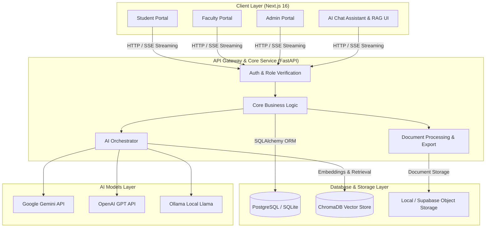
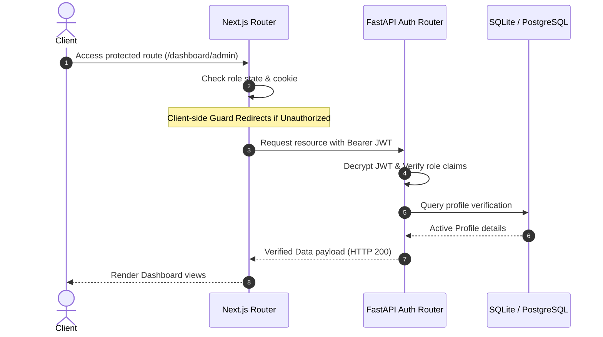

# 🎓 CampusGPT — AI-Powered Campus Management Platform

> A production-ready, full-stack AI-powered campus management platform with intelligent study tools, placement preparation, and role-based dashboards for students, faculty, and administrators.

---

## 🏛️ System Architecture

CampusGPT is designed as a decoupled full-stack application featuring a Next.js frontend, a FastAPI backend, and a pluggable database/AI layer.



### Role-Based Access Control Flow



---

## 📁 Project Folder Structure

```
campusgpt/
├── backend/                  # FastAPI Application
│   ├── app/
│   │   ├── api/              # API route controllers (Student, Faculty, Admin, Placement, Notes, etc.)
│   │   ├── core/             # Configuration, security credentials, request logging, & rate limit middleware
│   │   ├── db/               # SQLAlchemy engine initialization and session management
│   │   ├── models/           # SQLAlchemy ORM schemas
│   │   ├── schemas/          # Pydantic validation schemas
│   │   └── services/         # Business services (AI providers, Vector Store RAG, document exports)
│   ├── tests/                # Automated API endpoint test suites
│   ├── Dockerfile            # Production-ready non-root Docker runner
│   └── requirements.txt      # Backend Python dependencies
├── frontend/                 # Next.js Application
│   ├── src/
│   │   ├── app/              # App router pages (Student portal, Faculty portal, Auth, Layouts)
│   │   ├── components/       # Reusable components, Error boundaries, & UI blocks
│   │   ├── context/          # React context handlers (Auth state, Chat state, Theme state)
│   │   ├── hooks/            # Reusable utility hooks
│   │   └── lib/              # API client and service bindings
│   ├── public/               # Static assets & icons
│   ├── Dockerfile            # Optimized production multi-stage Docker build
│   └── package.json          # Node dependencies & package scripts
├── supabase/                 # Supabase setup scripts
│   └── migrations/           # Database migration SQL definitions
├── docker-compose.yml        # Orchestrated development and production configurations
└── README.md                 # Project root documentation
```

---

## 🔧 Environment Configuration

To configure the application, duplicate the `.env.example` file in both `backend` and `frontend` directories to `.env` and fill in your values.

### Backend Configurations (`backend/.env`)

| Variable | Type | Description | Default |
|----------|------|-------------|---------|
| `DATABASE_URL` | String | Connection string for PostgreSQL. Leave blank for fallback SQLite mode. | `""` |
| `SUPABASE_URL` | String | (Optional) Supabase API endpoint url. | `""` |
| `SUPABASE_KEY` | String | (Optional) Supabase service key. | `""` |
| `JWT_SECRET` | String | Private key used to sign JWT authentication credentials. | `supersecret...` |
| `AI_PROVIDER` | Enum | Pluggable AI backend: `mock` \| `ollama` \| `gemini` \| `openai` | `mock` |
| `OLLAMA_API_BASE` | String | Endpoint of local Ollama server if using `ollama` provider. | `http://localhost:11434` |
| `OLLAMA_MODEL` | String | Model used inside local Ollama server. | `llama3.2` |
| `GEMINI_API_KEY` | String | API Key for Google Gemini if using `gemini` provider. | `""` |
| `OPENAI_API_KEY` | String | API Key for OpenAI if using `openai` provider. | `""` |
| `OPENAI_MODEL` | String | Model used inside OpenAI (e.g. `gpt-4o-mini`). | `gpt-4o-mini` |
| `PORT` | Integer | Network port for uvicorn server. | `8000` |
| `DEBUG` | Boolean | Enables debug logging & bypass checks for local testing. | `false` |
| `CORS_ORIGINS` | String | Allowed client origins separated by commas. | `http://localhost:3000` |

### Frontend Configurations (`frontend/.env.local`)

| Variable | Type | Description | Default |
|----------|------|-------------|---------|
| `NEXT_PUBLIC_SUPABASE_URL` | String | Supabase url for client-side Auth. Leave blank to trigger Mock fallback. | `""` |
| `NEXT_PUBLIC_SUPABASE_ANON_KEY` | String | Supabase anonymous key for client auth. Leave blank to trigger Mock fallback. | `""` |
| `NEXT_PUBLIC_API_URL` | String | Root URL for the FastAPI backend service. | `http://localhost:8000/api/v1` |

---

## 🚀 Getting Started

### Option 1: Local Development

#### Prerequisites
- Python 3.12+
- Node.js 20+
- npm or yarn

#### 1. Setup Backend
```bash
# Navigate to backend
cd backend

# Create virtual environment
python -m venv venv
source venv/bin/activate  # On Windows use: venv\Scripts\activate

# Install dependencies
pip install -r requirements.txt

# Setup local env file
cp .env.example .env

# Run FastAPI server
uvicorn app.main:app --reload --port 8000
```
- API swagger will be available at `http://localhost:8000/docs`

#### 2. Setup Frontend
```bash
# Navigate to frontend
cd ../frontend

# Install dependencies
npm install

# Setup env file
cp .env.example .env.local

# Run Next.js developer server
npm run dev
```
- Client portal will be active at `http://localhost:3000`

---

### Option 2: Docker Compose (Orchestrated)

Ensure Docker Desktop is running, then launch the multi-container stack from the root directory:

```bash
# Build and run containers in detached mode
docker-compose up --build -d

# Check live logs of running containers
docker-compose logs -f

# Check container health status
docker-compose ps
```

FastAPI server runs on `http://localhost:8000`, and Next.js frontend listens on `http://localhost:3000`.

---

## 🛡️ Production Security & Safeguards

- **JWT Auth Encryption**: Uses standard `HS256` token validation. Falling back to Supabase auth client signatures.
- **Strict Role Boundaries**: Enforced dynamically at both FastAPI routes (using `Depends(get_current_admin)`) and client routing levels (reacting in layouts/page structures).
- **Request Rate Limiter**: Controls API abuse through sliding window rate checks, backed by auto-pruning structures to clear stale cache memory.
- **Security Headers**: Explicit security declarations (`X-Frame-Options: DENY`, `X-Content-Type-Options: nosniff`) are delivered inside all Next.js responses.

---

## 🧪 Testing

### Running Backend API Tests
Run the comprehensive pytests suite with coverage output:
```bash
cd backend
python -m pytest tests/ -v --cov=app
```

### Running Frontend Validation
```bash
cd frontend
npm run lint
npm run build
```

---

## 📸 Screenshots & Dashboards

Here is an overview of the production interfaces designed for CampusGPT:

| View Interface | Dashboard Layout Placeholder | Key Features Displayed |
|---|---|---|
| **Landing Page** | `[ 📸 Public Portal Landing Screen ]` | Elegant hero grids, testimonials slider, dynamic FAQs accordion, and responsive navigation header. |
| **Student Portal** | `[ 📸 Student Performance Dashboard ]` | Dynamic GPA statistics, interactive calendar widget, upcoming coursework lists, and exam countdowns. |
| **Faculty Portal** | `[ 📸 Faculty grading & Class Manager ]` | Uploading syllabuses, managing student attendance tracking, grading submissions, and drafting notices. |
| **Admin Portal** | `[ 📸 System Administration Console ]` | System statistics charts, direct database audit logs viewer, user role alteration tables, and department creation. |
| **AI Chat Hub** | `[ 📸 Conversational Assistant Interface ]` | Session pinning, RAG document search tools, markdown LaTeX execution rendering, and token-streaming outputs. |

---

## 📄 License

This software is distributed under the MIT License. See `LICENSE` for more information.